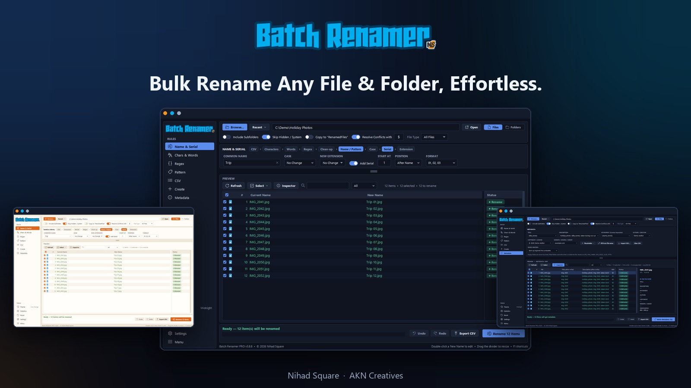
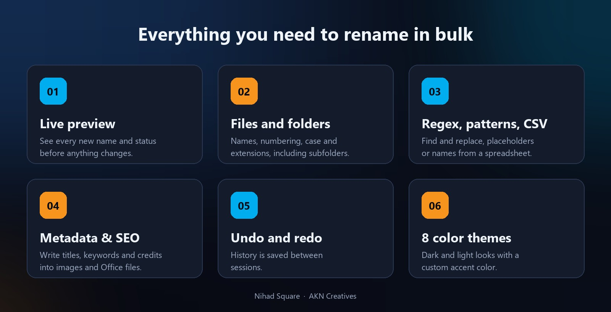
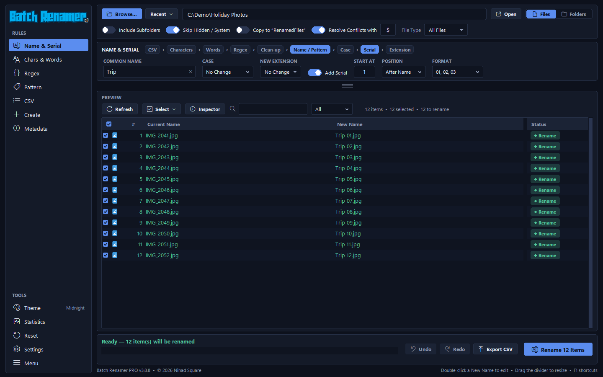
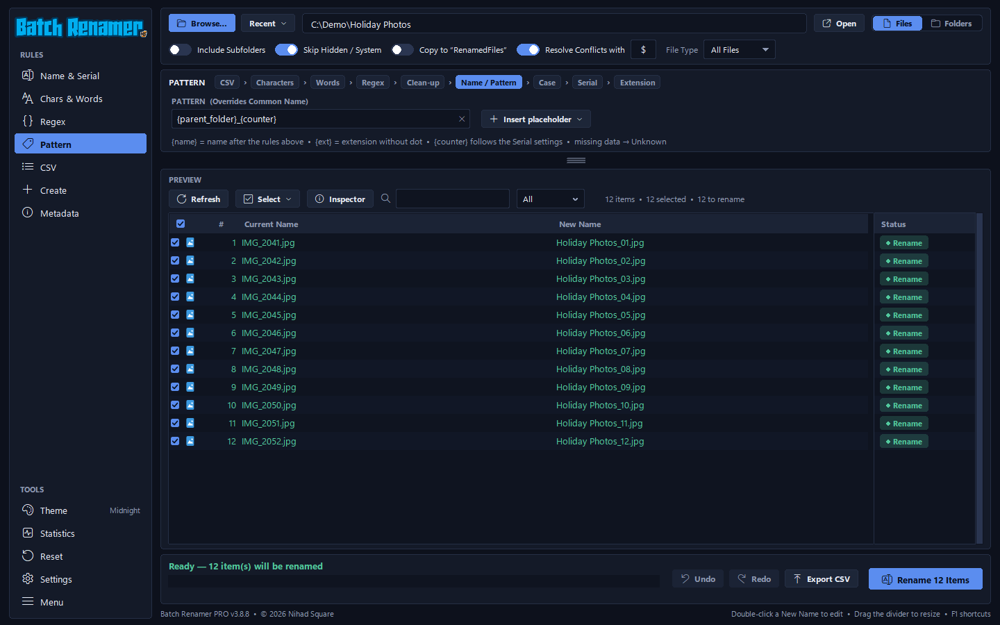
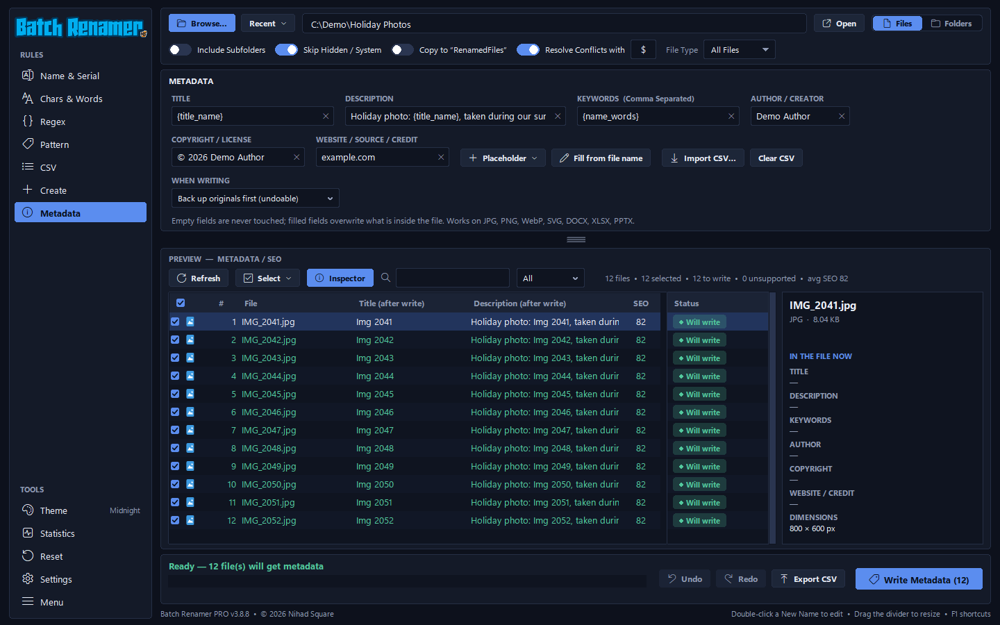
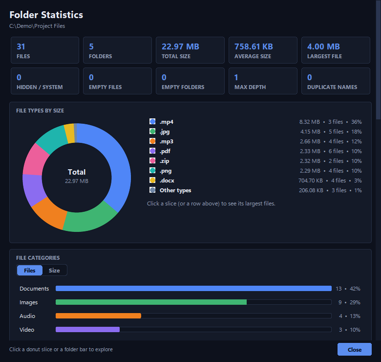
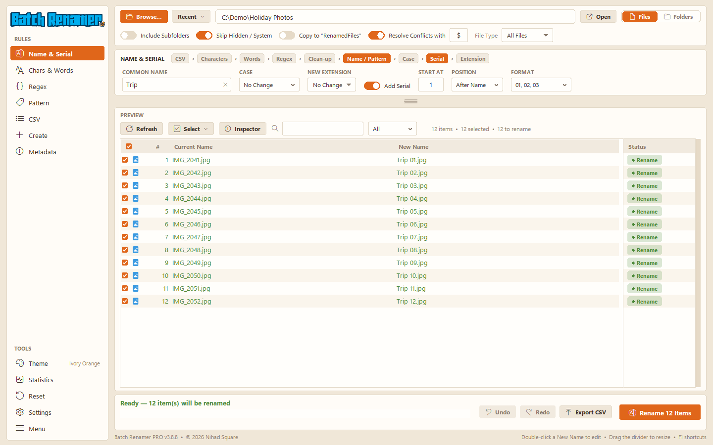

### Bulk Rename Any File & Folder, Effortless.

**[⬇ Download for Windows](https://github.com/NihadSquare/BatchRenamer/releases/latest)** · [User Guide](docs/USER_GUIDE.md) · [Changelog](CHANGELOG.md) · [Report a bug](https://github.com/NihadSquare/BatchRenamer/issues)

---

## ✨ Features

| | Feature | What it does |
|---|---|---|
| 🔤 | **Name & Serial** | Common name, case change, new extension, and 8 serial formats (numbers, letters, Roman) |
| 🧹 | **Chars & Words** | Remove or replace characters and whole words, with auto clean-up |
| 🧩 | **Regex** | Regular-expression find and replace with capture groups |
| 🏷️ | **Pattern** | Build names from placeholders: dates, size, parent folder, EXIF |
| 📄 | **CSV** | Import new names from a spreadsheet and export the preview |
| 🔎 | **Metadata & SEO** | Write titles, descriptions, keywords and credits into JPG, PNG, WebP, SVG, DOCX, XLSX and PPTX, with an SEO score |
| ➕ | **Create** | Make empty folders, TXT, CSV, PNG, JPG, PDF, DOCX and XLSX files in bulk |
| 📊 | **Statistics** | Charts of what is inside the selected folder |
| 🎨 | **Themes** | 8 color themes and a custom accent color |
| 📘 | **Built-in guide** | Searchable help and keyboard shortcuts |

## 🛡 Safety first

- Nothing changes on disk until you press **Rename** or **Write Metadata**.
- **Two-phase renaming** handles swaps and chains without overwriting.
- Conflicts are resolved or skipped; invalid and reserved names are blocked.
- **Undo / redo** history is saved between sessions (100 steps by default).
- Extra confirmation for large batches and system folders.
- Recovery of unfinished renames after a crash.
- In-place metadata writing without backup **cannot** be undone; keep backups on.

## 🖼 Screenshots

| Pattern rules | Metadata & SEO |
|---|---|
|  |  |
| **Folder statistics** | **Light theme** |
|  |  |

---

## 📦 Install

1. Download `BatchRenamer.exe` from the [latest release](https://github.com/NihadSquare/BatchRenamer/releases/latest).
2. Double-click it. No installation or Python is needed.

The EXE is not code-signed, so Windows SmartScreen or antivirus software may warn you. Download only from this page; each release includes a SHA-256 checksum. The audio tag placeholders (`{artist}`, `{title}`, `{album}`) are not available in this build.

## 🚀 Quick start

1. **Browse** (`Ctrl+O`) to a folder and choose **Files** or **Folders**.
2. Pick a rules page in the sidebar. The preview updates as you type.
3. Check the **New name** column and status pills; untick anything to skip.
4. Press **Rename** (`Ctrl+R`). Use `Ctrl+Z` to undo.

Rules run in this order: **CSV › Characters › Words › Regex › Clean-up › Name / Pattern › Case › Serial › Extension**

All shortcuts and placeholders are listed in the [User Guide](docs/USER_GUIDE.md).

## 📄 License

Free to use for personal and commercial work. Copying, modifying, redistributing and reselling are not permitted without written permission. See the [license](LICENSE) and [third-party notices](THIRD_PARTY_NOTICES.md).

© 2023-2026 Nihad Square (AKN Creatives). All rights reserved.

## 👨‍💻 Developer

**Nihad Square** · **AKN Creatives**

[GitHub](https://github.com/NihadSquare) · [Contact](https://nihad.carrd.co)

⭐ If Batch Renamer saves you time, consider starring the repository.

